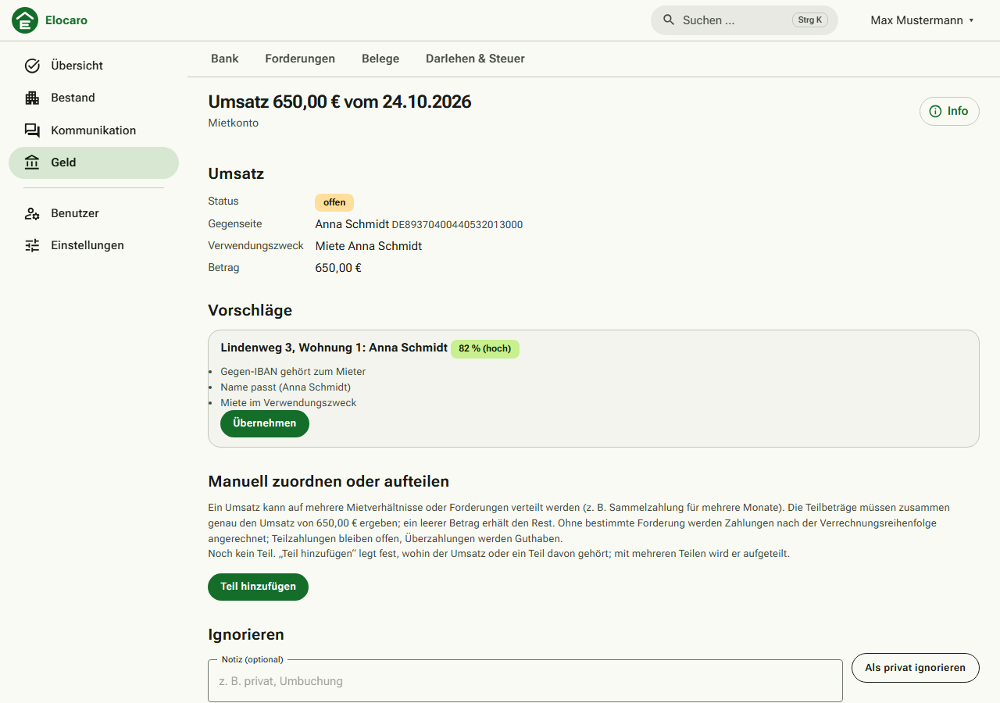
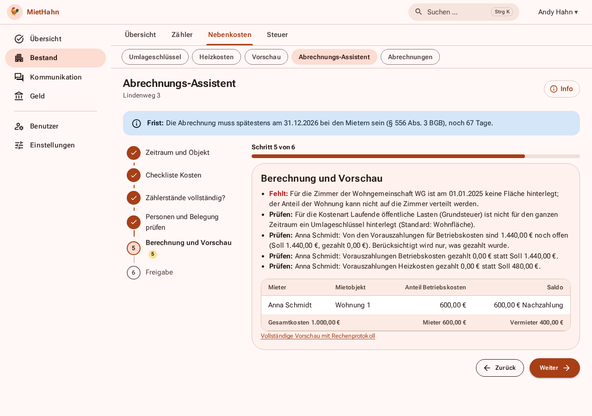
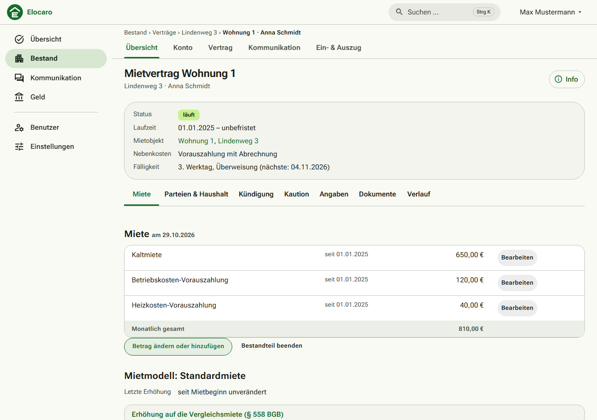
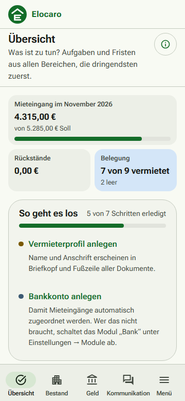

# MietHahn 🐓

**Die Vermieterverwaltung, die Ihnen gehört.** MietHahn ist eine selbst betriebene Verwaltung für private Vermieter: Objekte, Mieter und Verträge, Mieteingänge, Nebenkosten- und Heizkostenabrechnung, Steuerunterlagen und ein Mieterportal. Alle Daten liegen bei Ihnen, jederzeit vollständig exportierbar, ohne Abo und ohne Module hinter einer Bezahlschranke.



## Was MietHahn kann

- **Bestand:** Objekte, Wohnungen, WG-Zimmer als eigene Einheiten, Personen, Verträge (Standard-, Staffel-, Indexmiete), Eigentümer mit Anteilen.
- **Geld:** Mieterkonto mit automatischen Sollstellungen, Bankabgleich per Kontoauszug (CSV, CAMT, MT940) oder FinTS, Zuordnungsvorschläge mit Begründung, Mahnwesen mit Freigabe.
- **Abrechnung:** Betriebskostenabrechnung nach BetrKV und Heizkostenabrechnung nach HeizkostenV samt CO₂-Kostenaufteilung, geführter Assistent mit Fristwarnung, Plausibilitätsprüfungen vor dem Versand.
- **Steuer:** Anlage V je Objekt und Eigentümer, Abschreibung, Darlehen, Erhaltungsaufwand, DATEV-Export.
- **Kommunikation:** Mieterportal (Dokumente, Nachrichten, Schadensmeldungen, Verbrauch), Aushänge, Tickets für Hausmeister und Handwerker, Fristenkalender.
- **Dokumente:** Mietvertrag, Mieterhöhung, Übergabeprotokoll, Schreiben aus Vorlagen als PDF.
- **Betrieb:** Zwei-Faktor-Anmeldung, Audit-Log, nächtliche Datensicherung, Vollexport (JSON/CSV/Dateien), Handy-Oberfläche und installierbare Web-App.

| Abrechnungs-Assistent | Mietvertrag | Handy |
|---|---|---|
|  |  |  |

## Für wen ist das?

- **Gut geeignet:** private Vermieter mit etwa 3 bis 50 Einheiten, WG-Vermieter, Eigentümergemeinschaften, alle, die ihre Daten nicht in einer fremden Cloud haben wollen.
- **Voraussetzung:** ein eigener Server (VPS mit Docker, ab 2 GB RAM) und eine Domain. Die [Installation](docs/betrieb.md#installation) dauert mit dem Skript wenige Minuten.
- **Nicht gedacht für:** Hausverwaltungen mit vielen Mandanten, Gewerbe mit Umsatzsteuer, Wohnungseigentümergemeinschaften (WEG-Verwaltung).

## Ausprobieren

```bash
git clone https://github.com/TheR00st3r/MietHahn.git && cd MietHahn
./deploy/install.sh --lokal      # Probelauf auf https://localhost
./deploy/install.sh              # echte Installation mit Domain und Let's Encrypt
```

Der erste Aufruf führt durch die Ersteinrichtung (Administrator-Konto, Zwei-Faktor-Anmeldung, Einrichtungsassistent).

## Grenzen (ehrlich gesagt)

- MietHahn ist **keine Rechts- und keine Steuerberatung**. Vorlagen, Rechenwerte (Basiszinssatz, CO₂-Stufen, Gradtagszahlen) und Hinweise sind Arbeitshilfen. Prüfen Sie Texte und Beträge, bevor Sie sie verwenden oder versenden. Die Seite „Über MietHahn“ und die Seiteninfos nennen die jeweiligen Rechtsgrundlagen.
- Der FinTS-Abruf ist bisher nur gegen Beispieldaten getestet; Verfahren mit Bild-TAN (photoTAN, QR) werden noch nicht angezeigt. Der Kontoauszug-Import per Datei funktioniert unabhängig davon.
- Es gibt keine native App (nur die installierbare Web-App) und noch keine direkte ELSTER-Übermittlung.
- Betrieb, Updates und Datensicherung liegen bei Ihnen. Hilfe gibt es über die [Diskussionen](https://github.com/TheR00st3r/MietHahn/discussions) und [Issues](https://github.com/TheR00st3r/MietHahn/issues), nicht über eine Hotline.

**Stack:** .NET 10 · Blazor Static SSR · PostgreSQL · Docker Compose

## Dokumentation

- [Betrieb](docs/betrieb.md): Installation auf einem VPS, Update, Backup & Restore, Vollexport, Sicherheit
- [Installation auf anderen Plattformen](docs/installation-plattformen.md): Portainer, Coolify, Synology, Unraid, Proxmox, ARM
- [Marktanalyse](docs/marktanalyse.md) und [Produktbewertung](docs/produktbewertung.md): was bestehende Software gut und schlecht macht, wie MietHahn dasteht
- [Vertriebsplan](docs/vertriebsplan.md): Weg zur Veröffentlichung
- [Fachlichkeit & Anforderungen](docs/fachlichkeit.md): Ergebnis des Anforderungsinterviews
- [Architektur](docs/architektur.md): Technologie, Struktur, Meilensteine
- [Entwicklung](docs/entwicklung.md): lokale Umgebung, Migrationen, Konventionen, Tests
- [UI-Leitfaden](docs/ui.md)
- [Mitarbeiten](CONTRIBUTING.md): Ablauf, CI, Releases · [Änderungen](CHANGELOG.md) · [Sicherheit melden](SECURITY.md)
- [Banking & FinTS-Registrierung](docs/banking-fints.md)
- [Architekturentscheidungen (ADR)](docs/adr/)

## Umsetzungsplan

Der Plan liegt in den GitHub-Issues: ein Epic je Meilenstein, darunter Sub-Issues mit Aufgaben und Akzeptanzkriterien.

| Meilenstein | Epic |
|---|---|
| M0 Fundament (Solution, CI, Docker, Auth, PDF-Engine) | #1 |
| M1 Stammdaten (Objekte, WG-Zimmer, Verträge, Zähler) | #12 |
| M2 Finanzen & Bank (Sollstellungen, CSV/CAMT/MT940, FinTS, Mahnwesen, Belege + KI) | #19 |
| M3 Nebenkosten & Heizkosten (BetrKV, HeizkostenV, CO₂) | #27 |
| M4 Steuer (AfA, Darlehen, Anlage V, DATEV) | #35 |
| M5 Dokumente & Fristen (Vorlagen, Mieterhöhung, Protokolle) | #41 |
| M6 Mieterportal & Service (Tickets, Aushänge) | #47 |
| M7 Später (ERiC, Eigentümer je Objekt, Funkzähler) | #52 |
| V0 Vertrieb: Grundlagen | #65 |
| V1 Vertrieb: Die erste Stunde | #66 |
| V2 Vertrieb: Vertrauen | #67 |
| V3 Vertrieb: Reichweite | #68 |
| V4 Vertrieb: Einnahmen (Pilot) | #70 |

## Entwicklung

```bash
dotnet build && dotnet test   # Integrationstests brauchen Docker
dotnet run --project src/MietHahn.Web
```

Details zu lokaler Datenbank, Migrationen und Konventionen stehen in [docs/entwicklung.md](docs/entwicklung.md).

## Unterstützen

MietHahn ist ein Nebenprojekt und bleibt frei nutzbar. Fehlerberichte und Erfahrungen helfen am meisten; wer das Projekt außerdem tragen möchte, findet die Wege in [docs/foerderung.md](docs/foerderung.md): regelmäßige Unterstützung, [Feature-Sponsoring](docs/feature-sponsoring.md) und das geplante [Rechtsstände-Abo](docs/rechtsstaende-abo.md).

## Lizenz

MietHahn steht unter der [GNU Affero General Public License v3.0](LICENSE). Drittanbieter-Komponenten und ihre Lizenzen: [THIRD-PARTY-NOTICES.md](THIRD-PARTY-NOTICES.md). Version, Lizenz und Quellcode-Link zeigt auch die Seite „Über MietHahn“ (`/ueber`).
