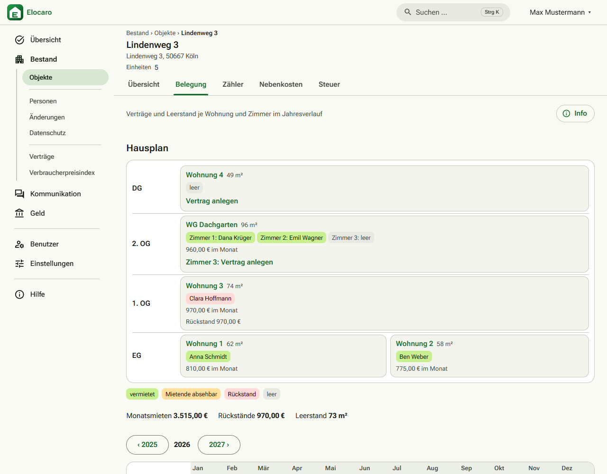
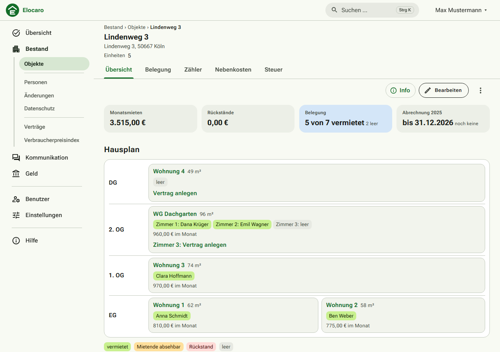
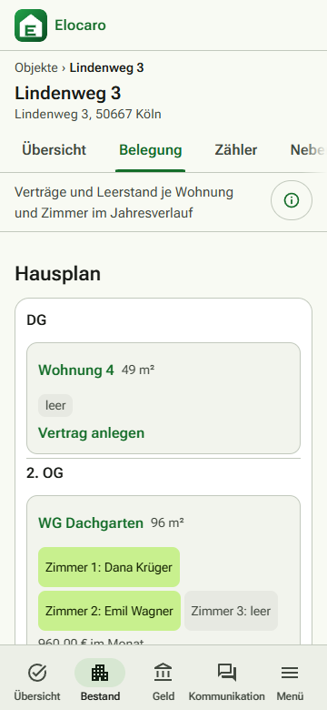

# Elocaro

**Die Vermieterverwaltung, die Ihnen gehört.** Elocaro ist eine selbst betriebene Verwaltung für private Vermieter: Objekte, Mieter und Verträge, Mieteingänge, Nebenkosten- und Heizkostenabrechnung, Steuerunterlagen und ein Mieterportal. Alle Daten liegen bei Ihnen, jederzeit vollständig exportierbar, ohne Abo und ohne Module hinter einer Bezahlschranke.



## Was Elocaro kann

- **Bestand:** Objekte, Wohnungen, WG-Zimmer als eigene Einheiten, Personen, Verträge (Standard-, Staffel-, Indexmiete), Eigentümer mit Anteilen.
- **Geld:** Mieterkonto mit automatischen Sollstellungen, Bankabgleich per Kontoauszug (CSV, CAMT, MT940) oder FinTS, Zuordnungsvorschläge mit Begründung, Mahnwesen mit Freigabe.
- **Abrechnung:** Betriebskostenabrechnung nach BetrKV und Heizkostenabrechnung nach HeizkostenV samt CO₂-Kostenaufteilung, geführter Assistent mit Fristwarnung, Plausibilitätsprüfungen vor dem Versand.
- **Steuer:** Anlage V je Objekt und Eigentümer, Abschreibung, Darlehen, Erhaltungsaufwand, DATEV-Export.
- **Kommunikation:** Mieterportal (Dokumente, Nachrichten, Schadensmeldungen, Verbrauch), Aushänge, Tickets für Hausmeister und Handwerker, Fristenkalender.
- **Dokumente:** Mietvertrag, Mieterhöhung, Übergabeprotokoll, Schreiben aus Vorlagen als PDF.
- **Betrieb:** Zwei-Faktor-Anmeldung, Audit-Log, nächtliche Datensicherung, Vollexport (JSON/CSV/Dateien), Handy-Oberfläche und installierbare Web-App.

| Objekt mit Einheiten | Umsätze zuordnen | Handy |
|---|---|---|
|  |  |  |

## Für wen ist das?

- **Gut geeignet:** private Vermieter mit etwa 3 bis 50 Einheiten, WG-Vermieter, Eigentümergemeinschaften, alle, die ihre Daten nicht in einer fremden Cloud haben wollen.
- **Voraussetzung:** ein eigener Server (VPS mit Docker, ab 2 GB RAM) und eine Domain. Die [Installation](docs/betrieb.md#installation) dauert mit dem Skript wenige Minuten.
- **Nicht gedacht für:** Hausverwaltungen mit vielen Mandanten, Gewerbe mit Umsatzsteuer, Wohnungseigentümergemeinschaften (WEG-Verwaltung).

## Ausprobieren

Ohne Installation: die **[Demo](https://demo.elocaro.de)** mit erfundenen Beispieldaten. Auf der Anmeldeseite eine Rolle wählen (Administrator, Verwalter, Hausmeister, Handwerker, Eigentümer, Mieter); sie wird jede Nacht zurückgesetzt.

Auf dem eigenen Rechner oder Server:

```bash
git clone https://github.com/Elocaro/elocaro.git && cd elocaro
./deploy/install.sh --lokal      # Probelauf auf https://localhost
./deploy/install.sh              # echte Installation mit Domain und Let's Encrypt
```

Der erste Aufruf führt durch die Ersteinrichtung (Administrator-Konto, Zwei-Faktor-Anmeldung, Einrichtungsassistent).

## Grenzen

Elocaro ist **keine Rechts- und keine Steuerberatung**. Vorlagen und Rechenwerte sind Arbeitshilfen; bitte vor dem Einsatz prüfen. Hilfe gibt es über die [Issues](https://github.com/Elocaro/elocaro/issues).

**Stack:** .NET 10 · Blazor Static SSR · PostgreSQL · Docker Compose

## Dokumentation

- [Website](https://elocaro.de) (eigenes Repository: [Elocaro/website](https://github.com/Elocaro/website))
- [Anwenderhandbuch](docs/handbuch.md): erste Schritte und die häufigsten Aufgaben für Vermieter (auch in der Anwendung unter „Hilfe“)
- [Betrieb](docs/betrieb.md): Installation auf einem VPS, Update, Backup & Restore, Vollexport, Sicherheit
- [Installation auf anderen Plattformen](docs/installation-plattformen.md): Portainer, Coolify, Synology, Unraid, Proxmox, ARM
- [Fachlichkeit & Anforderungen](docs/fachlichkeit.md): Rollen, Fachmodell und Festlegungen
- [Architektur](docs/architektur.md): Technologie und Struktur
- [Entwicklung](docs/entwicklung.md): lokale Umgebung, Migrationen, Konventionen, Tests
- [UI-Leitfaden](docs/ui.md)
- [Mitarbeiten](CONTRIBUTING.md): Ablauf, CI, Releases · [Änderungen](CHANGELOG.md) · [Sicherheit melden](SECURITY.md)
- [Banking & FinTS-Registrierung](docs/banking-fints.md)
- [Architekturentscheidungen (ADR)](docs/adr/)

## Entwicklung

```bash
dotnet build && dotnet test   # Integrationstests brauchen Docker
dotnet run --project src/Elocaro.Web
```

Details zu lokaler Datenbank, Migrationen und Konventionen stehen in [docs/entwicklung.md](docs/entwicklung.md).

## Unterstützen

Elocaro ist ein Nebenprojekt und bleibt frei nutzbar. Fehlerberichte und Erfahrungen helfen am meisten; wer das Projekt außerdem tragen möchte, findet die Wege in [docs/foerderung.md](docs/foerderung.md): regelmäßige Unterstützung und [Feature-Sponsoring](docs/feature-sponsoring.md).

## Lizenz

Elocaro steht unter der [GNU Affero General Public License v3.0](LICENSE). Drittanbieter-Komponenten und ihre Lizenzen: [THIRD-PARTY-NOTICES.md](THIRD-PARTY-NOTICES.md). Version, Lizenz und Quellcode-Link zeigt auch die Seite „Über Elocaro“ (`/ueber`).
