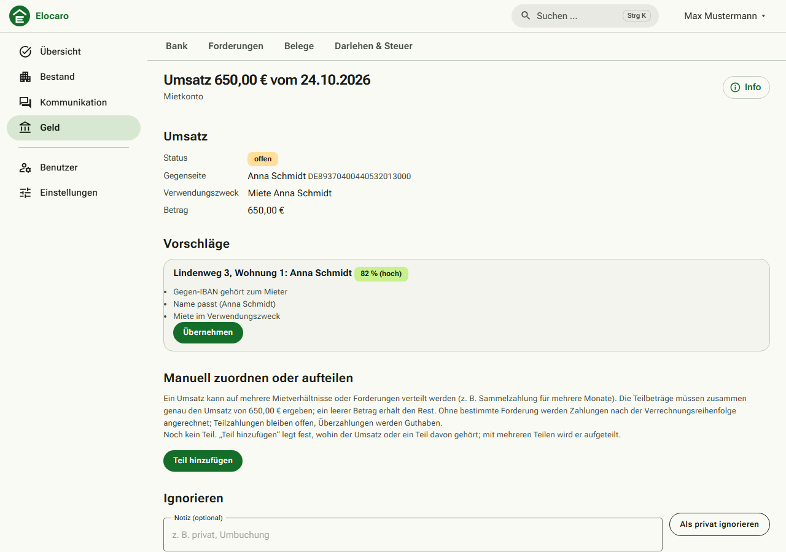
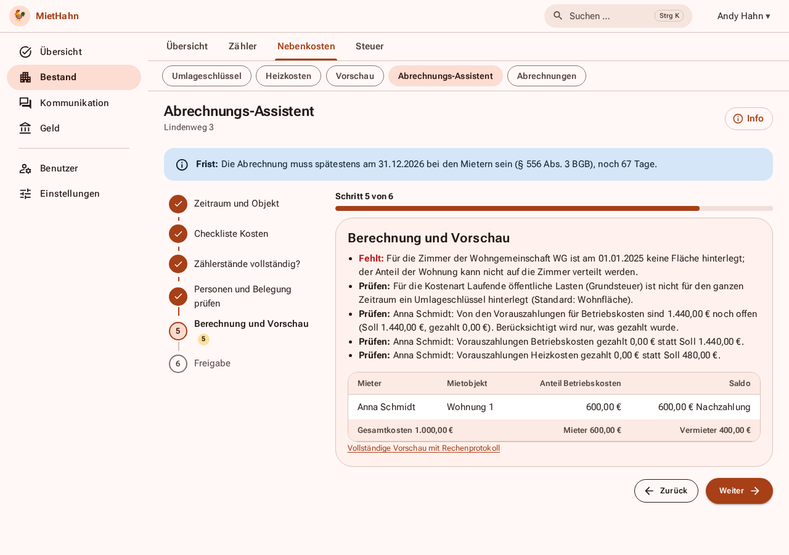
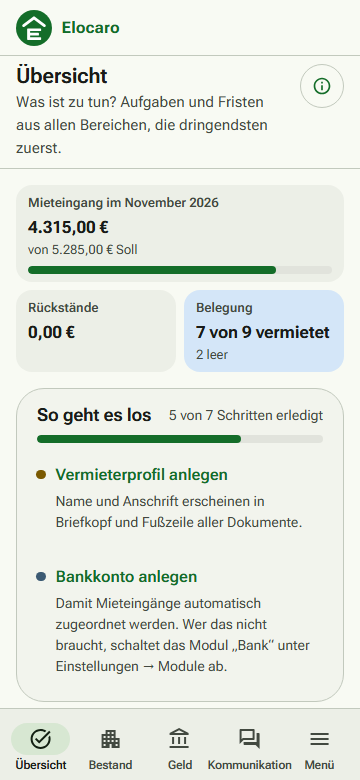

# Anwenderhandbuch

Dieses Handbuch ist für Vermieter, die Elocaro benutzen. Betrieb und Installation stehen in [betrieb.md](betrieb.md). Dieselben Anleitungen, dazu häufige Fragen und ein Glossar, stehen in der Anwendung selbst: Benutzermenü → **Hilfe** (`/verwaltung/hilfe`). Mieter finden ihre Hilfe im Portal unter `/portal/hilfe`.

## Erste Schritte

1. **Vermieterprofil** (Einstellungen → Vermieter): Name, Anschrift, Bankverbindung. Sie stehen auf allen Schreiben.
2. **Objekt und Einheiten** (Bestand → Objekte → Neu): das Haus, dann die Wohnungen mit Wohnfläche.
3. **Mieter und Vertrag** (Bestand → Verträge → Neu): Mieter, Mietbeginn, Kaltmiete, Betriebskostenvorauszahlung, Kaution.
4. **Zahlungen** (Bank): Konto anlegen, Umsätze importieren; Elocaro ordnet sie den Forderungen zu.
5. **Mieterzugang** (Personen → Mieter → Portalzugang): damit der Mieter Konto, Dokumente und Meldungen selbst sieht.

Der Einrichtungsassistent auf der Übersicht führt durch die ersten Schritte. Wer schon Daten in einer Tabelle hat, nutzt Einstellungen → Datenimport; zum Ausprobieren gibt es Beispieldaten (ebenda).

## Aufgaben

| Aufgabe | Wo | Kurz |
|---|---|---|
| Mieter anlegen | Bestand → Personen → Neu | Name, Anrede, Anschrift, E-Mail; danach im Vertrag wählen |
| Zahlung zuordnen | Geld → Bank → Zuordnen | Vorschlag bestätigen; mit Regeln geht es künftig automatisch. Barzahlungen im Mieterkonto des Vertrags |
| Nebenkosten abrechnen | Belege, dann Objekt → Abrechnung | Zeitraum, Kostenarten, Verteilung prüfen; Zugang beim Mieter binnen zwölf Monaten nach Ende des Zeitraums |
| Miete erhöhen | Vertrag → Vertrag → Mieterhöhung | Verfahren wählen; Fristen und Grenzen werden gerechnet, das Schreiben entsteht als PDF |
| Zählerstände | Objekt → Zähler | Ablese-Runde, CSV-Import oder Meldung der Mieter im Portal prüfen und übernehmen |
| Mieterwechsel | Vertrag → Ein- & Auszug | Mieterwechsel, Übergabe Auszug mit Protokoll, Kaution abrechnen, danach neuer Vertrag |
| Bescheinigungen | Kommunikation → Dokumente → Schreiben an Mieter | Wohnungsgeberbestätigung, Mietbescheinigung, Mietschuldenfreiheit, Kautionsabrechnung |

## So sieht es aus

Umsätze zuordnen (Geld → Bank → Zuordnen): Vorschläge mit Begründung, bestätigen oder ändern.

Nebenkostenabrechnung (Bestand → Objekt → Nebenkosten → Abrechnungs-Assistent): Schritt für Schritt mit Prüfhinweisen. Wasser, Abwasser, Strom und Gas rechnet Elocaro nach Verbrauch und Tarif (Objekt → Nebenkosten → Versorgungsverträge): Preis je Einheit und Grundpreis eintragen, die Kosten ergeben sich aus den Zählerständen. Abschlagsrechnungen zählen nicht; die Jahresabrechnung des Versorgers erfassen Sie später als Beleg mit der Markierung „Jahresabrechnung des Versorgers“, sie ersetzt die Berechnung.

Auf dem Handy führt die untere Leiste zu Aufgaben, Bestand, Geld und Kommunikation.

## Begriffe

Sollstellung, Offener Posten, Saldovortrag, Umlageschlüssel und weitere Begriffe sind in der Hilfe der Anwendung (Abschnitt „Begriffe einfach erklärt“) beschrieben.

## Hinweis

Vorlagen, Berechnungen und Hinweise sind Arbeitshilfen und keine Rechts- oder Steuerberatung.
